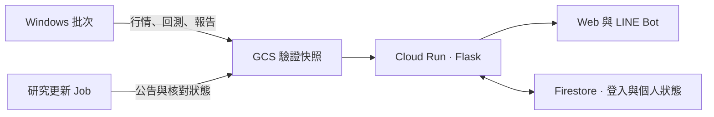

# ABSORB

ABSORB 是涵蓋台股與美股的市場研究平台。Web 提供大盤、產業、個股、公司事件與盤前／盤後報告。LINE Bot 提供快速查詢、關注清單和提醒。兩個入口共用自然語言研究助理 ASKsorb，讓使用者從回答回到原始資料與研究頁面。

[開啟 ABSORB](https://line-stock-bot-3visrvv4yq-de.a.run.app/) · [市場資料狀態](https://line-stock-bot-3visrvv4yq-de.a.run.app/health/data)

## 功能與入口

| 功能 | 內容 | Web 入口 |
| --- | --- | --- |
| 台股與美股觀察 | 大盤、產業、個股 K 線、報酬、成交量與異常事件。台股另有市場熱圖，支援個股比較。 | `/dashboard`、`/us`、`/market-map`、`/compare?symbols=2330,2317` |
| 個股報價 | 個股頁按需載入 Yahoo Finance 報價，標示來源與時間，報價可能延遲。歷史 K 線、觀察指標及報告沿用已驗證的收盤資料。 | `/stock/2330`、`/stock/AAPL` |
| 產業關係 | 首批收錄 AI 伺服器、半導體、電動車等八個產業。可用公司名稱、別名或代號搜尋，查閱供應、合作等關係的來源與核對日期。 | `/industries/relationships` |
| 公司事件與大咖動態 | 台股官方公告、已核對的公開觀點與原始來源。來源中斷時保留上次成功的資料，並標示更新狀態。 | `/events`、`/perspectives` |
| 盤前與盤後報告 | 台美股按交易日歸檔。盤後整理收盤觀察，盤前補充已驗證的隔夜資訊。台股專業盤後報告在來源齊備時納入 TWSE 法人買賣超金額。 | `/reports`、`/reports/us` |
| ASKsorb | 以自然語言查台美股的資料、報告與研究來源。Web 與 LINE 共用同一套研究工具。 | `/ask` |
| 個人工作區 | LINE Login 連接關注清單與提醒。登入後可建立、追蹤及匯出站內交易計畫。 | `/account/watchlist`、`/account/trading` |

LINE 可直接輸入股票代號（例如 `2330`）、`我的關注` 或 `提醒管理`。固定指令先由程式處理，自然語言問題再交給 ASKsorb。涉及新增或移除自選股、建立或取消提醒時，須先確認操作。

## 最近一次有驗收紀錄的正式發布

**2026-11-17（台北時間）**，Cloud Run 版本 `line-stock-bot-00330-moq`（來源 `6fa2b9f`）讀回為 100% 流量。候選版與正式站各通過 25 項冒煙測試，獨立切換驗證為 READY。發布來源的完整測試共 1,989 項，通過且有 2 項略過。

- **個股與搜尋**修正 `BRK.B`、`TAIEX` 與無效代號的導向，在正式站確認 GGLL 的個股圖表、期間切換、報價與報告入口。
- **美股日報**盤前排程接上報告發布。盤後重試前先驗證本機和 GCS 成品，只有確認該交易日已完整發布才略過重跑。台股盤前若缺隔夜美股資料，會標明缺項並保留盤後觀察。
- **研究更新**針對暫時性 HTTP 或非 JSON 回應加入有限重試。手動恢復執行後，10 個來源皆回報正常，並完成公開快照讀回。這次恢復執行只更新來源資料，當次未發布新觀點。

交易助手已開放 LINE 登入者使用，交易助手的 LINE 推播開關關閉。11 月這次驗收涵蓋公開頁面、手動恢復與資料讀回。登入後的私人流程、LINE 推播送達與下一次自然排程另需實測。最新市場日期與新鮮度請查 [資料狀態](https://line-stock-bot-3visrvv4yq-de.a.run.app/health/data)。

## 資料與部署架構



- **Windows 批次**透過 Task Scheduler 編排台美股盤前與盤後、補跑和研究用模型作業。批次在 `D:\AbsorbData` 產生資料、量化快照與報告。通過交易日、覆蓋率及完整性檢查後，先發布不可變成品與 manifest，再更新讀取指標。
- **Cloud Run 網站**以 Flask、Gunicorn 與 Jinja 提供 Web 和 LINE webhook。伺服器驗證 GCS 快照，並標示資料日期、過期或缺項。全市場計算、LightGBM 訓練、回測和 PDF 產生在批次端執行。
- **研究更新**由獨立 Cloud Run Job 擷取公司公告與公開研究來源，保留每個來源的成功時間、錯誤與待審狀態。通過審核的觀點才會出現在公開頁。
- **研究限制**預設為 `research` 模式，公開頁面呈現市場觀察，五日模型機率、排名、強行動標籤與績效背書保持關閉。工作樹中的 SEC 申報事件模組仍屬實驗功能，預設停用。

## 本機開發

Windows 使用 Python 3.10 和 PowerShell。以下指令從專案根目錄執行，Node.js 用於檢查 JavaScript。

```powershell
python -m venv .venv
.\.venv\Scripts\python.exe -m pip install -r requirements.txt
.\.venv\Scripts\python.exe app.py
```

開啟 [本機首頁](http://127.0.0.1:5000/) 或 [服務檢查](http://127.0.0.1:5000/healthz)。只啟動網站時，市場快照、真實 LINE Login 與 Gemini 功能視環境設定而定。

```powershell
.\.venv\Scripts\python.exe -m unittest discover -s tests -v
.\.venv\Scripts\python.exe -m compileall -q absorb stock_papi reporting backtest
node --check static/app.js
```

### 環境設定

以 [`.env.example`](.env.example) 對照變數名稱，透過 PowerShell 環境或部署設定注入。正式憑證由 Secret Manager 管理。

| 設定 | 用途 |
| --- | --- |
| `ABSORB_DATA_ROOT`、`ABSORB_REPORT_ROOT` | 本機資料及報告根目錄，預設為 `D:\AbsorbData` 與 `D:\AbsorbData\reports` |
| `GCP_PROJECT_ID`、`QUANT_SNAPSHOT_BUCKET` | GCP 專案及私有快照儲存桶 |
| `LINE_CHANNEL_ACCESS_TOKEN`、`LINE_CHANNEL_SECRET` | LINE Messaging API 與 webhook 驗證 |
| `LINE_LOGIN_CHANNEL_ID`、`LINE_LOGIN_CHANNEL_SECRET`、`LINE_LOGIN_REDIRECT_URI`、`SESSION_SECRET` | Web 登入與 session 設定。LINE Login 與 Messaging API 使用同一 Provider |
| `ASKSORB_GEMINI_API_KEY`、`GEMINI_API_KEY` | ASKsorb 專用 Gemini 設定及其他 Gemini 功能 |
| `ABSORB_PREDICTION_MODE` | 量化功能的顯示權限，預設 `research` |

`ABSORB_*` 是品牌遷移後的設定名稱，對應的舊 `STOCK_PAPI_*` 設定保留相容讀取。新舊變數同時存在但值不同時，程式會拒絕使用該組設定。

### 程式與維運文件

| 路徑 | 職責 |
| --- | --- |
| [`app.py`](app.py)、[`absorb/`](absorb) | Flask 入口、設定與 Web／LINE 共用研究對話 |
| [`stock_papi/`](stock_papi) | 市場資料、批次、LINE 整合、Web 路由與儲存介面 |
| [`reporting/`](reporting)、[`backtest/`](backtest) | 報告、量化研究與回測 |
| [`scripts/`](scripts) | Windows 排程及部署腳本。排程定義見 [`install_pipeline_tasks.ps1`](scripts/install_pipeline_tasks.ps1)，執行入口為 [`invoke_pipeline_task.ps1`](scripts/invoke_pipeline_task.ps1) |

- [技術架構](docs/architecture_overview.md)
- [報告操作手冊](docs/dual-daily-report-runbook.md)
- [部署與回復](docs/deployment/README.md)
- [資料及排程遷移](docs/migration/README.md)
- [設計規範](DESIGN.md)
